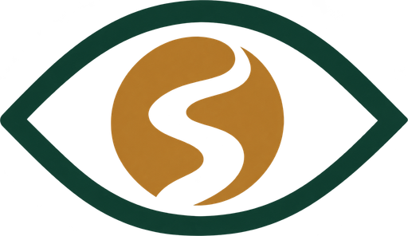
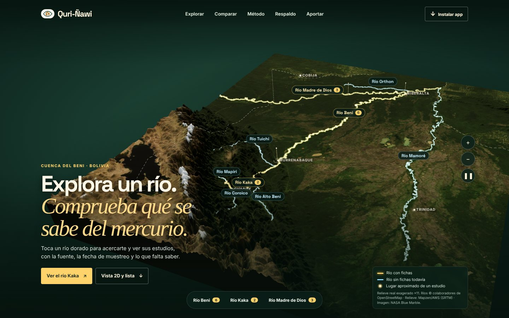
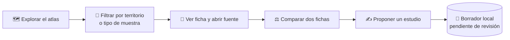

  

<h1 align="center">Curinawi</h1>

  <b>Atlas de evidencia sobre mercurio · Cuenca del Beni, Bolivia</b> 
  Explora estudios sobre mercurio, comprueba sus fuentes y decide qué falta investigar.

  
  
  
  
  
  
  

  

> [!NOTE]
> Curinawi es la aplicación del equipo **Golden Eye** para **Gold for Good · ORO-3.3**, «Mapa vivo de estudios y proyectos sobre mercurio». El piloto se centra en la cuenca del Beni y la primera consulta se plantea en el río Kaka.

## 📈 Avance al 25 de noviembre

La aplicación ya cubre el recorrido de consulta: explorar la cuenca, abrir la fuente, comparar dos fichas y proponer un estudio. La revisión humana, los permisos y la prueba con usuarios son el siguiente tramo.

| Bloque del plan | Estado | Qué funciona hoy | Qué falta |
| --- | :---: | --- | --- |
| 🗺️ **Catálogo y mapa** | ✅ | Atlas esquemático con vista de mapa y relieve 3D, búsqueda y filtros por territorio y tipo de muestra. | Filtro por especie cuando aplique. |
| 📖 **Fichas** | 🟡 | 6 fichas semilla con fuente enlazada y fechas de muestreo y publicación separadas. | Revisarlas y llegar a 5 estudios revisados con página o tabla de respaldo. |
| ⚖️ **Comparar evidencia** | 🟡 | Dos fichas lado a lado, con una nota que explica los límites de la comparación. | Analito, método y unidad como campos; señal de posibles duplicados. |
| ✍️ **Aportes** | 🟡 | Borradores en el navegador, con validación de DOI o enlace `https://` y control de repetidos. | Envío a revisión y persistencia en servidor. |
| 🧾 **Extracción y revisión** | ⏳ | — | Cargar un PDF, sugerir campos con página y corregir antes de publicar. |
| 🔐 **Permisos e historial** | ⏳ | Solo se sirven registros públicos. | Roles, historial, retiro y registros restringidos. |
| 📱 **PWA** | ✅ | Instalable. Tras la primera carga, la portada y el catálogo se consultan sin conexión. | — |
| 🤖 **Agentes** | 🟡 | Catálogo público en JSON en `/api/catalogo`. | Conectar el MCP de referencia a la misma vista. |
| 👥 **Validación con usuarios** | ⏳ | — | Prueba cronometrada y registro del ajuste realizado. |
| 🧪 **Calidad** | ✅ | CI con lint, tipos, compilación y `npm audit`; prueba HTTP de portada, API y PWA. | Pruebas en navegador. |

✅ listo · 🟡 en curso · ⏳ pendiente

## ✨ Qué puedes hacer hoy

<table>
  <tr>
    <td width="62%"></td>
    <td>
      <h3>🗺️ Explorar la cuenca</h3>
      Selecciona un río en el atlas o filtra por territorio y tipo de muestra. Cada ficha abre su nota, la fecha de muestreo y el enlace a la fuente.
        
      Alterna entre <b>Mapa</b> y <b>Relieve 3D</b>. La geometría es esquemática y las ubicaciones, aproximadas.
    </td>
  </tr>
  <tr>
    <td></td>
    <td>
      <h3>⚖️ Comparar dos registros</h3>
      Pon dos fichas lado a lado. En el caso del Kaka, la app recuerda que ambas observaciones son de 1998, vienen de la misma revisión y les falta el método y el punto exacto.
    </td>
  </tr>
  <tr>
    <td align="center"></td>
    <td>
      <h3>📱 Llevarla en el celular</h3>
      La interfaz se adapta a pantallas pequeñas y se instala como app desde <b>Instalar app</b>.
        
      <h3>🧭 Recorrido con Quri</h3>
      Una guía de tres pasos lleva de la exploración a la comparación y al aporte.
        
      <h3>✍️ Proponer un estudio</h3>
      Guarda el título, el DOI o enlace y el territorio como borrador para revisión.
    </td>
  </tr>
</table>

