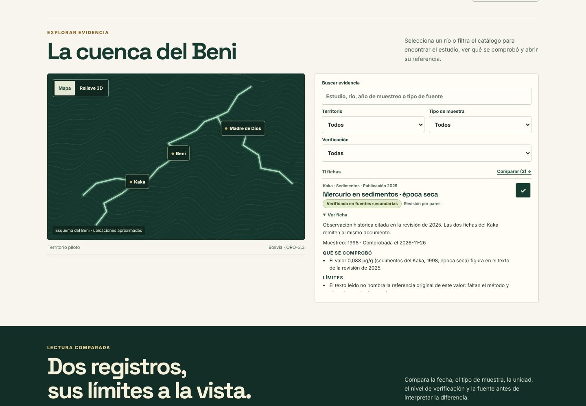
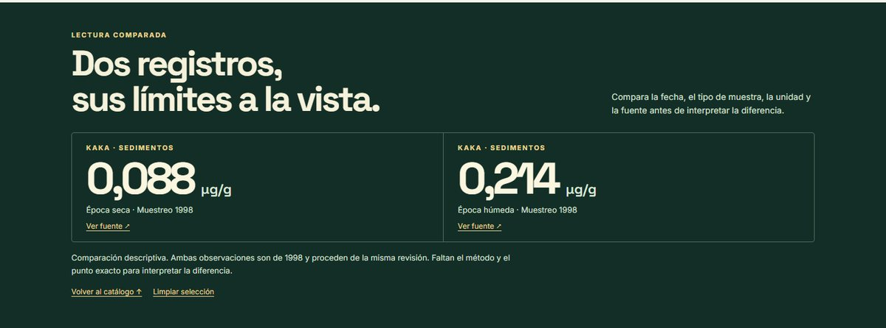
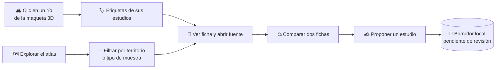
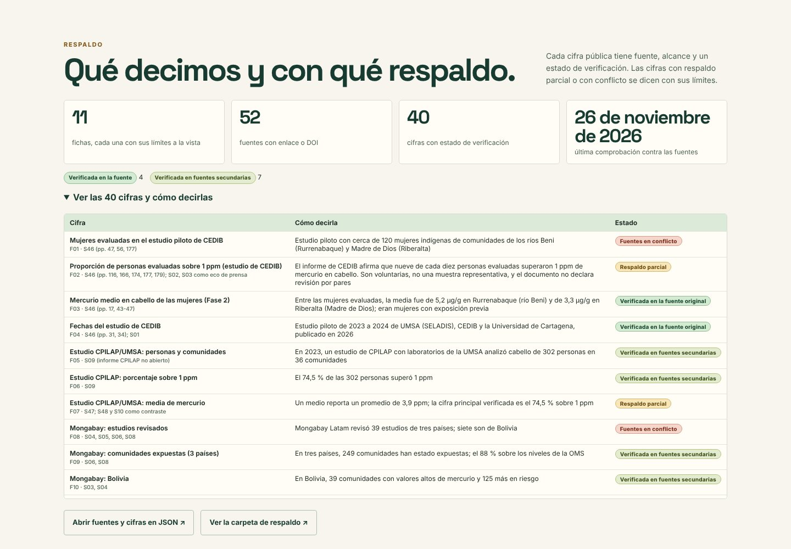
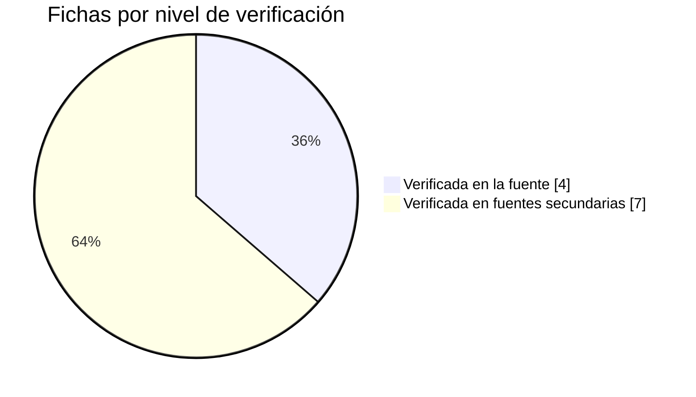
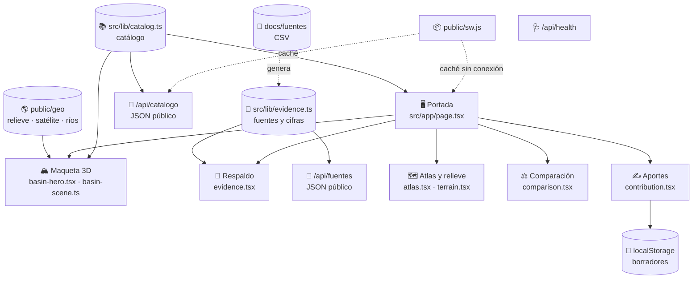
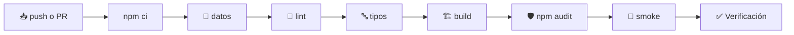

<p align="center">
  
</p>

<h1 align="center">Quri-Ñawi</h1>

<p align="center">
  <b>Atlas de evidencia sobre mercurio · Cuenca del Beni, Bolivia</b><br>
  Explora estudios sobre mercurio, comprueba sus fuentes y decide qué falta investigar.
</p>

<p align="center">
  <a href="https://github.com/Quri-Nawi/Quri-Nawi/actions/workflows/ci.yml"></a>
  
  
  
  
  
  
</p>

<p align="center">
  
</p>

> [!NOTE]
> Quri-Ñawi es la aplicación del equipo **GoldnEye** para **Gold for Good · ORO-3.3**, «Mapa vivo de estudios y proyectos sobre mercurio». El piloto se centra en la cuenca del Beni y la primera consulta se plantea en el río Kaka.

<p align="center">
  <a href="#-avance-al-26-de-noviembre">Avance</a> ·
  <a href="#-qué-puedes-hacer-hoy">Funciones</a> ·
  <a href="#-catálogo-y-respaldo">Catálogo</a> ·
  <a href="#-viabilidad">Viabilidad</a> ·
  <a href="#-arquitectura">Arquitectura</a> ·
  <a href="#-arranque-rápido">Arranque</a> ·
  <a href="#-hoja-de-ruta">Hoja de ruta</a>
</p>

## 📈 Avance al 26 de noviembre

La aplicación ya cubre el recorrido de consulta: explorar la cuenca, abrir la fuente, comparar dos fichas y proponer un estudio. La revisión humana, los permisos y la prueba con usuarios son el siguiente tramo.

| Bloque del plan | Estado | Qué funciona hoy | Qué falta |
| --- | :---: | --- | --- |
| 🗺️ **Catálogo y mapa** | ✅ | Portada 3D con relieve real que gira sola; clic en un río para acercarse y ver sus fichas. Vista 2D, búsqueda y filtros por territorio y tipo de muestra. | Filtro por especie cuando aplique. |
| 📖 **Fichas** | ✅ | 11 fichas con nivel de verificación, qué se comprobó, límites y fuentes enlazadas; fechas de muestreo y publicación separadas. | Revisión por especialistas y organizaciones dueñas de los datos. |
| 🧾 **Respaldo de datos** | ✅ | 52 fuentes y 40 cifras con estado y redacción segura, en la app, en `/api/fuentes` y en `docs/fuentes`. `npm run datos` falla si algo no cuadra. | Revisión periódica (ver `docs/fuentes/LIMITES_Y_MANTENIMIENTO.md`). |
| ⚖️ **Comparar evidencia** | 🟡 | Dos fichas lado a lado, con una nota que explica los límites de la comparación. | Analito, método y unidad como campos; señal de posibles duplicados. |
| ✍️ **Aportes** | 🟡 | Borradores en el navegador, con validación de DOI o enlace `https://` y control de repetidos. | Envío a revisión y persistencia en servidor. |
| 🧾 **Extracción y revisión** | ⏳ | — | Cargar un PDF, sugerir campos con página y corregir antes de publicar. |
| 🔐 **Permisos e historial** | ⏳ | Solo se sirven registros públicos. | Roles, historial, retiro y registros restringidos. |
| 📱 **PWA** | ✅ | Instalable. Tras la primera carga, la portada y el catálogo se consultan sin conexión. | — |
| 🤖 **Agentes** | 🟡 | Catálogo y respaldo en JSON en `/api/catalogo` y `/api/fuentes`, con ID, versión, procedencia y fecha de consulta. | Desplegar el adaptador de lectura de GoldEye Trace; revisar cada ficha antes de autorizarla en su catálogo canónico. |
| 👥 **Validación con usuarios** | ⏳ | Plan y criterio de éxito en [docs/viabilidad.md](docs/viabilidad.md). | Hacer la prueba con 5 a 8 personas. **Aún no se ha hecho.** |
| 🧪 **Calidad** | ✅ | CI con validación de datos, lint, tipos, compilación y `npm audit`; prueba HTTP de portada, respaldo, APIs y PWA. | Pruebas en navegador. |

<sub>✅ listo · 🟡 en curso · ⏳ pendiente</sub>

## ✨ Qué puedes hacer hoy

<table>
  <tr>
    <td width="62%"></td>
    <td>
      <h3>🏔️ Recorrer la cuenca en 3D</h3>
      La portada es una maqueta de la cuenca del Beni con <b>relieve real</b>, imagen satelital y los ríos de OpenStreetMap. Gira sola; los ríos con fichas brillan en dorado.
      <br><br>
      Haz clic en un río y la cámara se acerca. A cada lado aparecen sus estudios: tipo de muestra, valor y unidad, fecha de muestreo y de publicación, precisión del lugar, estado de revisión y fuente. El panel indica qué falta en el catálogo para ese río.
      <br><br>
      Comparte un río con un enlace como <code>/?rio=Kaka</code>.
    </td>
  </tr>
  <tr>
    <td></td>
    <td>
      <h3>🗺️ Vista 2D y lista</h3>
      Selecciona un río en el atlas o filtra por territorio y tipo de muestra. Cada ficha abre su nota, la fecha de muestreo y el enlace a la fuente.
      <br><br>
      Alterna entre <b>Mapa</b> y <b>Relieve 3D</b>. La geometría es esquemática y las ubicaciones, aproximadas.
    </td>
  </tr>
  <tr>
    <td></td>
    <td>
      <h3>⚖️ Comparar dos registros</h3>
      Pon dos fichas lado a lado. En el caso del Kaka, la app recuerda que ambas observaciones son de 1998, vienen de la misma revisión y les falta el método y el punto exacto.
    </td>
  </tr>
  <tr>
    <td align="center"></td>
    <td>
      <h3>📱 Llevarla en el celular</h3>
      La interfaz se adapta a pantallas pequeñas y se instala como app desde <b>Instalar app</b>.
      <br><br>
      <h3>🧭 Recorrido con Quri</h3>
      Una guía de tres pasos lleva de la exploración a la comparación y al aporte.
      <br><br>
      <h3>✍️ Proponer un estudio</h3>
      Guarda el título, el DOI o enlace y el territorio como borrador para revisión.
    </td>
  </tr>
</table>



## 📚 Catálogo y respaldo

Las fichas viven en [`src/lib/catalog.ts`](src/lib/catalog.ts); las fuentes y cifras, en [`src/lib/evidence.ts`](src/lib/evidence.ts), espejo de [`docs/fuentes`](docs/fuentes/README.md). La interfaz y las APIs leen los mismos registros. Comprobado el **26 de noviembre de 2026**.

| Ficha | Territorio | Tipo | Muestreo | Verificación | Fuente |
| --- | --- | --- | --- | --- | --- |
| Mercurio en sedimentos · época seca | Kaka | Sedimentos | 1998 | Verificada en fuentes secundarias | [Revista Boliviana de Química · revisión de la cuenca del Beni](https://www.scielo.org.bo/scielo.php?lng=en&nrm=iso&pid=S0250-54602025000200097&script=sci_arttext&tlng=en) |
| Mercurio en sedimentos · época húmeda | Kaka | Sedimentos | 1998 | Verificada en fuentes secundarias | [Revista Boliviana de Química · revisión de la cuenca del Beni](https://www.scielo.org.bo/scielo.php?lng=en&nrm=iso&pid=S0250-54602025000200097&script=sci_arttext&tlng=en) |
| Elementos traza en peces comestibles del Beni | Beni | Peces | Jul–ago 2015 | Verificada en la fuente | [Rodriguez-Levy et al. · Heliyon](https://pubmed.ncbi.nlm.nih.gov/36444265/) |
| Composición nutricional y mercurio en peces del Beni | Beni | Peces | No indicada en la reseña | Verificada en fuentes secundarias | [Loayza et al. · J Food Compos Anal 150:108840 · reseña UMSA](https://dipgis.umsa.bo/?p=7902) |
| Mercurio en cabello de mujeres de Rurrenabaque (río Beni) | Beni | Datos agregados | 2023–2024 | Verificada en la fuente | [CEDIB, SELADIS-UMSA y Universidad de Cartagena · Mercurio y salud en la Amazonía boliviana](https://www.cedib.org/biblioteca/mercurio-y-salud-en-la-amazonia-boliviana-roger-carvajal/) |
| Mercurio en cabello de mujeres de Riberalta (Madre de Dios) | Madre de Dios | Datos agregados | 2023–2024 | Verificada en la fuente | [CEDIB, SELADIS-UMSA y Universidad de Cartagena · Mercurio y salud en la Amazonía boliviana](https://www.cedib.org/biblioteca/mercurio-y-salud-en-la-amazonia-boliviana-roger-carvajal/) |
| Mercurio en cabello de 302 personas de 36 comunidades indígenas (CPILAP y UMSA) | Beni | Datos agregados | 2022–2023 | Verificada en fuentes secundarias | [Mongabay Latam · informe de CPILAP con laboratorios de la UMSA](https://es.mongabay.com/2023/07/pueblos-indigenas-presentan-altos-indices-de-mercurio-en-su-cuerpo-bolivia/) |
| Dragas de oro en el río Madre de Dios (CEJIS, 2021) | Madre de Dios | Datos agregados | Ago–sep 2021 | Verificada en fuentes secundarias | [Mongabay Latam · estudio de CEJIS y CEDIB](https://es.mongabay.com/2022/10/estudio-revela-que-balsas-mineras-liberan-mercurio-en-el-rio-madre-de-dios-en-bolivia/) |
| Dragas en el TIM II del río Madre de Dios (2025) | Madre de Dios | Datos agregados | 2025 | Verificada en fuentes secundarias | [Mongabay Latam · estudio de 2025 sobre el Madre de Dios](https://es.mongabay.com/2025/05/bolivia-dragas-mineria-oro-ilegalmente-rio-madre-de-dios/) |
| Base de Mongabay Latam sobre mercurio en la Amazonía | Beni | Datos agregados | Estudios de 1997 a 2024 | Verificada en fuentes secundarias | [Mongabay Latam · base de datos y análisis](https://es.mongabay.com/2026/08/oro-toxico-mercurio-mineria-amenaza-comunidades-cuenca-rio-beni-bolivia/) |
| Programa planetGOLD Bolivia | Beni | Proyecto | No aplica (proyecto) | Verificada en la fuente | [planetGOLD Bolivia](https://www.planetgold.org/es/bolivia) |

<p align="center">
  
</p>



> [!IMPORTANT]
> Las dos fichas del Kaka remiten a la misma revisión, que no nombra la referencia original. Los peces se compraron en mercados, así que la ficha no confirma el punto de captura. Las fichas de CEDIB describen mujeres seleccionadas y voluntarias, no la población. La salud se muestra agregada, sin datos individuales ni ubicaciones precisas.

| Documento | Para qué sirve |
| --- | --- |
| [docs/fuentes](docs/fuentes/README.md) | Registro de fuentes, matriz de cifras, conflictos, comprobación de fuentes y límites. |
| [docs/fuentes/REDACCION_DE_CIFRAS.md](docs/fuentes/REDACCION_DE_CIFRAS.md) | Cómo citar cada cifra y cuáles no deben usarse. |
| [docs/viabilidad.md](docs/viabilidad.md) | Qué está demostrado, qué no, y cómo se probará el uso. |
| [docs/contrato-mcp-web.md](docs/contrato-mcp-web.md) | Contrato de lectura web–MCP, mapeo de campos y separación entre semillas y fichas autorizadas. |

## 🧭 Viabilidad

Resumen de [docs/viabilidad.md](docs/viabilidad.md): la necesidad (evidencia dispersa y contradictoria), la viabilidad técnica y la de los datos están **demostradas**; la ética está **diseñada pero no auditada**; la operativa y el **uso con personas reales no están probados**.

## 🧱 Arquitectura



| Lugar | Responsabilidad |
| --- | --- |
| `src/app` | Portada, estilos, manifiesto PWA y rutas HTTP (`/api/catalogo`, `/api/fuentes`, `/api/health`). |
| `src/components` | Maqueta 3D (Three.js), atlas 2D, relieve, comparación, aportes, guía Quri, instalación y secciones de método, impacto, agentes y escala. |
| `src/lib` | Identidad del proyecto, catálogo y registro de fuentes y cifras. |
| `public` | Logo, íconos, tipografías, *service worker* y datos de la cuenca en `public/geo`. |
| `scripts/geodatos.py` | Regenera relieve, imagen satelital y ríos de `public/geo` desde fuentes públicas. |
| `scripts/validar-datos.mjs` | Comprueba que fichas, fuentes y cifras sean coherentes entre sí y con los CSV. |
| `scripts/smoke.mjs` | Prueba HTTP de la app en ejecución. |
| `docs` | Respaldo de datos, viabilidad y capturas. |
| `.github` | CI de verificación y actualizaciones con Dependabot. |

Más detalle en [docs/architecture.md](docs/architecture.md).

## 🚀 Arranque rápido

Usa **Node.js 24.22.3** y **npm 11.19.1**, las versiones de [`.node-version`](.node-version) y [`package.json`](package.json). No necesitas un archivo `.env`, credenciales ni una base de datos para arrancar esta versión. Los datos del mapa vienen incluidos en el repositorio.

1. Si aún no tienes el repositorio, clónalo y entra a la carpeta. Si ya lo tienes, abre una terminal dentro de la carpeta que contiene `package.json`.

   ```sh
   git clone https://github.com/Quri-Nawi/Quri-Nawi.git
   cd Quri-Nawi
   ```

2. Comprueba las versiones e instala las dependencias según `package-lock.json`.

   ```sh
   node --version
   npm --version
   npm ci --ignore-scripts
   ```

   En Windows, si PowerShell bloquea `npm.ps1`, usa `npm.cmd` en lugar de `npm` en los comandos de esta guía.

3. Inicia el servidor de desarrollo y abre [localhost:3000](http://localhost:3000) en el navegador.

   ```sh
   npm run dev
   ```

   Deja abierta la terminal mientras usas la app. Para detenerla, pulsa `Ctrl+C`. Si el puerto 3000 está ocupado, puedes usar `npm run dev -- --port 3001` y abrir [localhost:3001](http://localhost:3001).

### 📱 Probar la instalación y el modo sin conexión

Después de instalar las dependencias, detén el servidor de desarrollo y ejecuta la versión de producción:

```sh
npm run build
npm start
```

Abre [localhost:3000](http://localhost:3000) con conexión, pulsa **Instalar app** y sigue las indicaciones del navegador. Cuando la app indique que el catálogo está preparado, prueba a desactivar la red y recargar. El *service worker* se registra en producción. Para probar desde otro dispositivo, usa una URL con HTTPS.

Con el servidor en ejecución, abre una segunda terminal y ejecuta `npm run smoke` para comprobar la portada, la API, la PWA y los archivos del mapa. Si usas otro puerto, indica la dirección con `QURI_SMOKE_URL`. En PowerShell, por ejemplo:

```powershell
$env:QURI_SMOKE_URL = "http://localhost:3001"
npm run smoke
```


## ✅ Verificaciones

| Comando | Qué comprueba |
| --- | --- |
| `npm run datos` | Fichas, fuentes y cifras coherentes: toda ficha declara verificación, comprobado, límites y fuentes existentes; toda cifra tiene estado y redacción segura; los CSV dicen lo mismo que la app (título, URL, estado, valor y frase segura). |
| `npm run check` | Validación de datos, lint, tipos y compilación de producción. |
| `npm audit --audit-level=low` | Vulnerabilidades conocidas en las dependencias. |
| `npm run smoke` | Con la app en marcha: portada y sección de respaldo, `/api/health`, `/api/catalogo` y `/api/fuentes` coherentes entre sí, manifiesto PWA, *service worker* y cabeceras de seguridad. Usa `QURI_SMOKE_URL` para otra dirección. |



El CI corre en cada *pull request* y en cada cambio a `main`.

## 🧭 Hoja de ruta

| Orden | Bloque | Siguiente entrega |
| :---: | --- | --- |
| 1 | 📖 **Fichas revisadas** | Revisión por especialistas y por las organizaciones dueñas de los datos. |
| 2 | ⚖️ **Comparar evidencia** | Comparar con matriz, analito, unidad, método, época y precisión del sitio. |
| 3 | ✍️ **Revisar y publicar** | Revisión humana, permisos, persistencia e historial. |
| 4 | 👥 **Validar con usuarios** | Prueba cronometrada con 5 a 8 personas (criterio en [docs/viabilidad.md](docs/viabilidad.md)). |
| 5 | 🤖 **Agentes** | Conectar el MCP de referencia a la misma vista pública. |


## 🔐 Datos y seguridad

- 🏷️ Solo se publican registros públicos. Los borradores se quedan en el navegador de quien los crea.
- 🩺 Los datos de salud se muestran agregados, sin datos individuales ni ubicaciones precisas.
- 📄 Los estudios de terceros se enlazan; no se redistribuyen sus PDF.
- 🧾 Ninguna cifra se publica sin fuente, alcance y estado. Los límites de lo que no se puede afirmar están en [docs/fuentes/LIMITES_Y_MANTENIMIENTO.md](docs/fuentes/LIMITES_Y_MANTENIMIENTO.md).
- 🔑 Las credenciales se configuran fuera del código. Ver [SECURITY.md](SECURITY.md).

## 🤝 Contribuir

Trabaja en una rama desde `main`, limita el cambio a una sección y abre una solicitud de cambios con el resultado de `npm run check`. Si cambias una cifra, edita el CSV de `docs/fuentes` y su frase segura en el mismo cambio. Guía completa en [CONTRIBUTING.md](CONTRIBUTING.md).

## 🔗 Enlaces y créditos

- 🎬 [Aplicación pública Quri-Ñawi](https://quri-nawi.vercel.app/), referencia visual y del servidor MCP.
- 🏆 [Gold for Good Hackathon](https://gold4good.info.bo/site/). Su logo aparece en el pie de la app como crédito a la hackathon.
- 🗺️ Ríos © colaboradores de [OpenStreetMap](https://www.openstreetmap.org/copyright) (ODbL). Relieve: [Terrain Tiles](https://registry.opendata.aws/terrain-tiles/) de Mapzen en AWS Open Data (SRTM, GMTED, ETOPO1). Imagen: NASA Blue Marble vía GIBS. Frontera: Natural Earth.
- 🎨 El logo de Quri-Ñawi se generó con ImageGen. Los detalles están en [docs/architecture.md](docs/architecture.md#créditos-de-imagen).
- 🔤 Tipografías Inter y Space Grotesk, con licencia SIL Open Font License 1.1.

---

<p align="center">
  <sub>Hecho con 💛 por el equipo <b>GoldnEye</b> · Gold for Good · Oro Responsable Bolivia 2026</sub>
</p>

## Revisión del 26 de noviembre

[Observaciones y resolución](docs/observaciones-26-nov.md) · [Guion de pitch en PDF](docs/pitch/guion-pitch.pdf) · [Guion editable](docs/pitch/guion-pitch.md) · [Protocolo de validación](docs/protocolo-validacion-usuarios.md).
