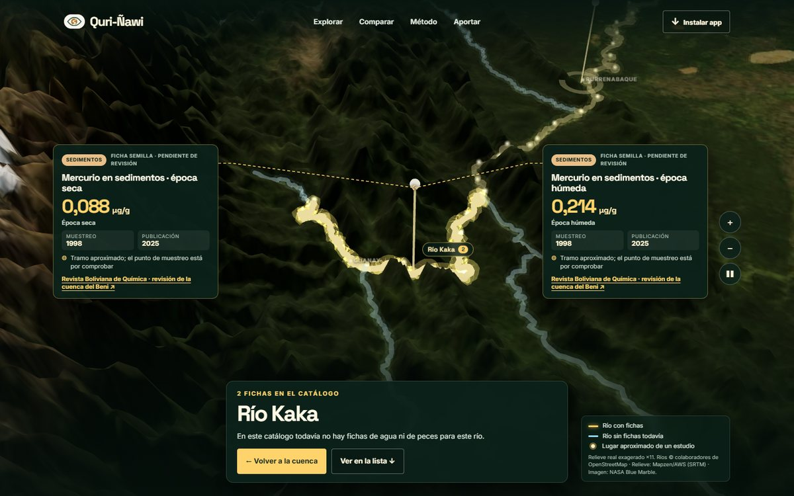
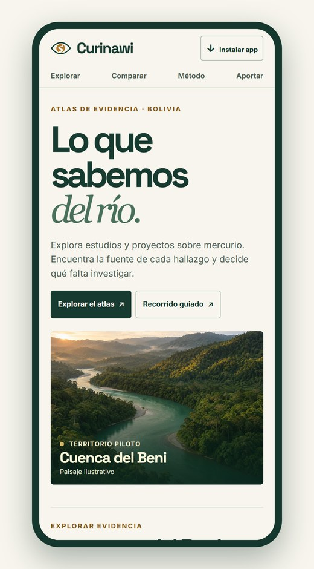
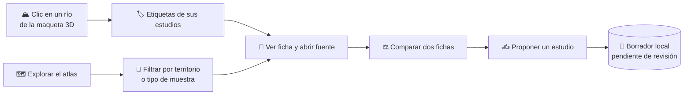
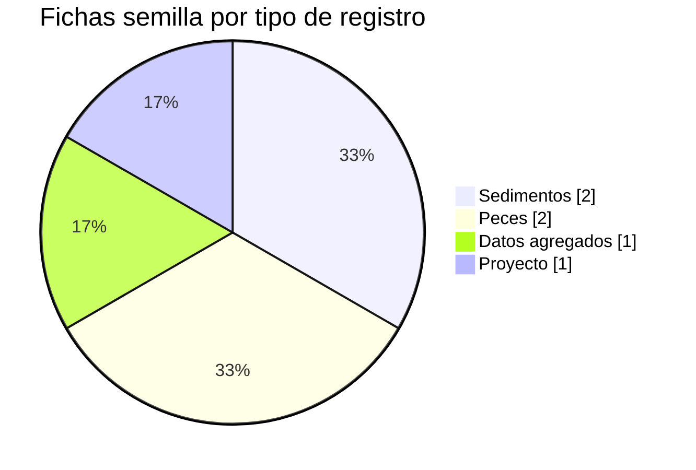
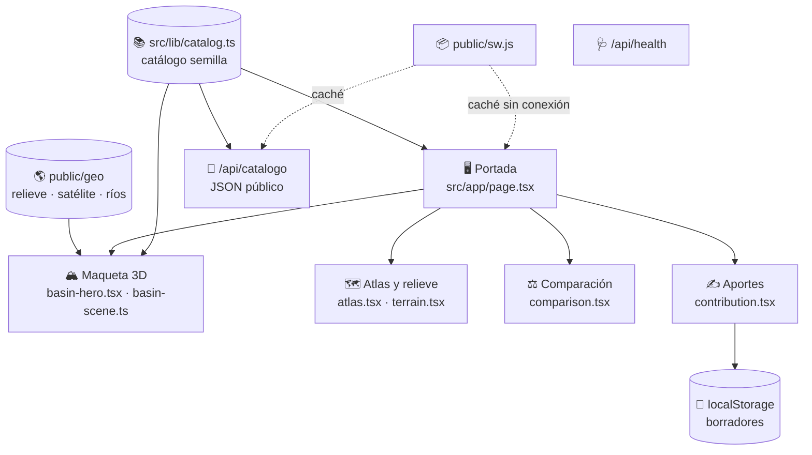
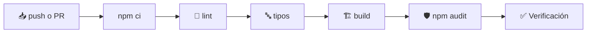
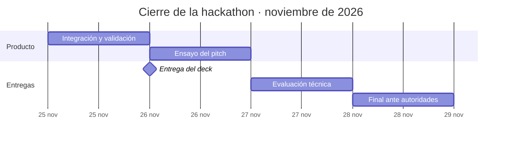

<p align="center">
  
</p>

<h1 align="center">Quri-Ñawi</h1>

<p align="center">
  <b>Atlas de evidencia sobre mercurio · Cuenca del Beni, Bolivia</b><br>
  Explora estudios sobre mercurio, comprueba sus fuentes y decide qué falta investigar.
</p>

<p align="center">
  <a href="https://github.com/Quri-Nawi/Quri-Nawi/actions/workflows/ci.yml"></a>
  
  
  
  
  
  
</p>

<p align="center">
  
</p>

> [!NOTE]
> Quri-Ñawi es la aplicación del equipo **GoldnEye** para **Gold for Good · ORO-3.3**, «Mapa vivo de estudios y proyectos sobre mercurio». El piloto se centra en la cuenca del Beni y la primera consulta se plantea en el río Kaka.

<p align="center">
  <a href="#-avance-al-25-de-noviembre">Avance</a> ·
  <a href="#-qué-puedes-hacer-hoy">Funciones</a> ·
  <a href="#-catálogo-semilla">Catálogo</a> ·
  <a href="#-arquitectura">Arquitectura</a> ·
  <a href="#-arranque-rápido">Arranque</a> ·
  <a href="#-hoja-de-ruta">Hoja de ruta</a>
</p>

## 📈 Avance al 25 de noviembre

La aplicación ya cubre el recorrido de consulta: explorar la cuenca, abrir la fuente, comparar dos fichas y proponer un estudio. La revisión humana, los permisos y la prueba con usuarios son el siguiente tramo.

| Bloque del plan | Estado | Qué funciona hoy | Qué falta |
| --- | :---: | --- | --- |
| 🗺️ **Catálogo y mapa** | ✅ | Portada 3D con relieve real que gira sola; clic en un río para acercarse y ver sus fichas. Vista 2D, búsqueda y filtros por territorio y tipo de muestra. | Filtro por especie cuando aplique. |
| 📖 **Fichas** | 🟡 | 6 fichas semilla con fuente enlazada y fechas de muestreo y publicación separadas. | Revisarlas y llegar a 5 estudios revisados con página o tabla de respaldo. |
| ⚖️ **Comparar evidencia** | 🟡 | Dos fichas lado a lado, con una nota que explica los límites de la comparación. | Analito, método y unidad como campos; señal de posibles duplicados. |
| ✍️ **Aportes** | 🟡 | Borradores en el navegador, con validación de DOI o enlace `https://` y control de repetidos. | Envío a revisión y persistencia en servidor. |
| 🧾 **Extracción y revisión** | ⏳ | — | Cargar un PDF, sugerir campos con página y corregir antes de publicar. |
| 🔐 **Permisos e historial** | ⏳ | Solo se sirven registros públicos. | Roles, historial, retiro y registros restringidos. |
| 📱 **PWA** | ✅ | Instalable. Tras la primera carga, la portada y el catálogo se consultan sin conexión. | — |
| 🤖 **Agentes** | 🟡 | Catálogo público en JSON en `/api/catalogo`. | Conectar el MCP de referencia a la misma vista. |
| 👥 **Validación con usuarios** | ⏳ | — | Prueba cronometrada y registro del ajuste realizado. |
| 🧪 **Calidad** | ✅ | CI con lint, tipos, compilación y `npm audit`; prueba HTTP de portada, API y PWA. | Pruebas en navegador. |

<sub>✅ listo · 🟡 en curso · ⏳ pendiente</sub>

## ✨ Qué puedes hacer hoy

<table>
  <tr>
    <td width="62%"></td>
    <td>
      <h3>🏔️ Recorrer la cuenca en 3D</h3>
      La portada es una maqueta de la cuenca del Beni con <b>relieve real</b>, imagen satelital y los ríos de OpenStreetMap. Gira sola; los ríos con fichas brillan en dorado.
      <br><br>
      Haz clic en un río y la cámara se acerca. A cada lado aparecen sus estudios: tipo de muestra, valor y unidad, fecha de muestreo y de publicación, precisión del lugar, estado de revisión y fuente. El panel indica qué falta en el catálogo para ese río.
      <br><br>
      Comparte un río con un enlace como <code>/?rio=Kaka</code>.
    </td>
  </tr>
  <tr>
    <td></td>
    <td>
      <h3>🗺️ Vista 2D y lista</h3>
      Selecciona un río en el atlas o filtra por territorio y tipo de muestra. Cada ficha abre su nota, la fecha de muestreo y el enlace a la fuente.
      <br><br>
      Alterna entre <b>Mapa</b> y <b>Relieve 3D</b>. La geometría es esquemática y las ubicaciones, aproximadas.
    </td>
  </tr>
  <tr>
    <td></td>
    <td>
      <h3>⚖️ Comparar dos registros</h3>
      Pon dos fichas lado a lado. En el caso del Kaka, la app recuerda que ambas observaciones son de 1998, vienen de la misma revisión y les falta el método y el punto exacto.
    </td>
  </tr>
  <tr>
    <td align="center"></td>
    <td>
      <h3>📱 Llevarla en el celular</h3>
      La interfaz se adapta a pantallas pequeñas y se instala como app desde <b>Instalar app</b>.
      <br><br>
      <h3>🧭 Recorrido con Quri</h3>
      Una guía de tres pasos lleva de la exploración a la comparación y al aporte.
      <br><br>
      <h3>✍️ Proponer un estudio</h3>
      Guarda el título, el DOI o enlace y el territorio como borrador para revisión.
    </td>
  </tr>
</table>



## 📚 Catálogo semilla

Las fichas viven en [`src/lib/catalog.ts`](src/lib/catalog.ts). La interfaz y la API leen los mismos registros. Están pendientes de revisión.

| Ficha | Territorio | Tipo | Muestreo | Publicación | Fuente |
| --- | --- | --- | --- | --- | --- |
| Mercurio en sedimentos · época seca | Kaka | Sedimentos | 1998 | 2025 | [Revisión de la cuenca del Beni](https://www.scielo.org.bo/scielo.php?lng=en&nrm=iso&pid=S0250-54602025000200097&script=sci_arttext&tlng=en) |
| Mercurio en sedimentos · época húmeda | Kaka | Sedimentos | 1998 | 2025 | [Revisión de la cuenca del Beni](https://www.scielo.org.bo/scielo.php?lng=en&nrm=iso&pid=S0250-54602025000200097&script=sci_arttext&tlng=en) |
| Elementos traza en peces comestibles del Beni | Beni | Peces | Jul–ago 2015 | 2022 | [Rodriguez-Levy et al. · Heliyon](https://pubmed.ncbi.nlm.nih.gov/36444265/) |
| Composición nutricional y mercurio en peces del Beni | Beni | Peces | Consultar el artículo | 2025 (DOI) | [Reseña UMSA](https://dipgis.umsa.bo/?p=7902) |
| Mercurio y salud en la Amazonía boliviana | Madre de Dios | Datos agregados | 2023–2024 | 2026 | [SELADIS y CEDIB](https://www.cedib.org/biblioteca/mercurio-y-salud-en-la-amazonia-boliviana-roger-carvajal/) |
| Programa planetGOLD Bolivia | Beni | Proyecto | Alcance nacional | Programa vigente | [planetGOLD Bolivia](https://www.planetgold.org/es/bolivia) |



> [!IMPORTANT]
> Las dos fichas del Kaka remiten a la misma revisión. Los peces se compraron en mercados de Riberalta y Rurrenabaque, así que la ficha no confirma el punto de captura. La ficha de salud enlaza el informe y omite datos individuales y ubicaciones precisas.

## 🧱 Arquitectura



| Lugar | Responsabilidad |
| --- | --- |
| `src/app` | Portada, estilos, manifiesto PWA y rutas HTTP (`/api/catalogo`, `/api/health`). |
| `src/components` | Maqueta 3D (Three.js), atlas 2D, relieve, comparación, aportes, guía Quri, instalación y secciones de método, impacto, agentes y escala. |
| `src/lib` | Identidad del proyecto y catálogo semilla. |
| `public` | Logo, íconos, tipografías, *service worker* y datos de la cuenca en `public/geo`. |
| `scripts/geodatos.py` | Regenera relieve, imagen satelital y ríos de `public/geo` desde fuentes públicas. |
| `scripts/smoke.mjs` | Prueba HTTP de la app en ejecución. |
| `.github` | CI de verificación y actualizaciones con Dependabot. |

Más detalle en [docs/architecture.md](docs/architecture.md).

## 🚀 Arranque rápido

Requiere la versión de Node.js de [`.node-version`](.node-version) y npm con el lockfile del repositorio.

```sh
npm ci --ignore-scripts
npm run dev
```

Abre `http://localhost:3000`. El catálogo en JSON está en `/api/catalogo` y `/api/health` comprueba el arranque.

### 📱 Probar la PWA

```sh
npm run build
npm start
```

Desde HTTPS, usa **Instalar app** o la opción de instalar del navegador. Después de la primera carga en línea, la portada y el catálogo semilla se consultan sin conexión.

## ✅ Verificaciones

| Comando | Qué comprueba |
| --- | --- |
| `npm run check` | Lint, tipos y compilación de producción. |
| `npm audit --audit-level=low` | Vulnerabilidades conocidas en las dependencias. |
| `npm run smoke` | Con la app en marcha: portada, `/api/health`, `/api/catalogo` con fuentes `https`, manifiesto PWA y *service worker*. Usa `QURI_SMOKE_URL` para otra dirección. |



El CI corre en cada *pull request* y en cada cambio a `main`.

## 🧭 Hoja de ruta

| Orden | Bloque | Siguiente entrega |
| :---: | --- | --- |
| 1 | 📖 **Fichas revisadas** | Validar las fichas semilla con revisores, con página o tabla de respaldo. |
| 2 | ⚖️ **Comparar evidencia** | Comparar con matriz, analito, unidad, método, época y precisión del sitio. |
| 3 | ✍️ **Revisar y publicar** | Revisión humana, permisos, persistencia e historial. |
| 4 | 👥 **Validar con usuarios** | Prueba cronometrada: encontrar la fuente y explicar qué dato falta. |
| 5 | 🤖 **Agentes** | Conectar el MCP de referencia a la misma vista pública. |



## 🔐 Datos y seguridad

- 🏷️ Solo se publican registros públicos. Los borradores se quedan en el navegador de quien los crea.
- 🩺 Los datos de salud se muestran agregados, sin datos individuales ni ubicaciones precisas.
- 📄 Los estudios de terceros se enlazan; no se redistribuyen sus PDF.
- 🔑 Las credenciales se configuran fuera del código. Ver [SECURITY.md](SECURITY.md).

## 🤝 Contribuir

Trabaja en una rama desde `main`, limita el cambio a una sección y abre una solicitud de cambios con el resultado de `npm run check`. Guía completa en [CONTRIBUTING.md](CONTRIBUTING.md).

## 🔗 Enlaces y créditos

- 🎬 [Demo conceptual de Ale](https://qurinawi.vercel.app/), referencia visual y del servidor MCP.
- 🏆 [Gold for Good Hackathon](https://gold4good.info.bo/site/). Su logo aparece en el pie de la app como crédito a la hackathon.
- 🗺️ Ríos © colaboradores de [OpenStreetMap](https://www.openstreetmap.org/copyright) (ODbL). Relieve: [Terrain Tiles](https://registry.opendata.aws/terrain-tiles/) de Mapzen en AWS Open Data (SRTM, GMTED, ETOPO1). Imagen: NASA Blue Marble vía GIBS. Frontera: Natural Earth.
- 🎨 El logo de Quri-Ñawi se generó con ImageGen. Los detalles están en [docs/architecture.md](docs/architecture.md#créditos-de-imagen).
- 🔤 Tipografías Inter y Space Grotesk, con licencia SIL Open Font License 1.1.

---

<p align="center">
  <sub>Hecho con 💛 por el equipo <b>GoldnEye</b> · Gold for Good · Oro Responsable Bolivia 2026</sub>
</p>
