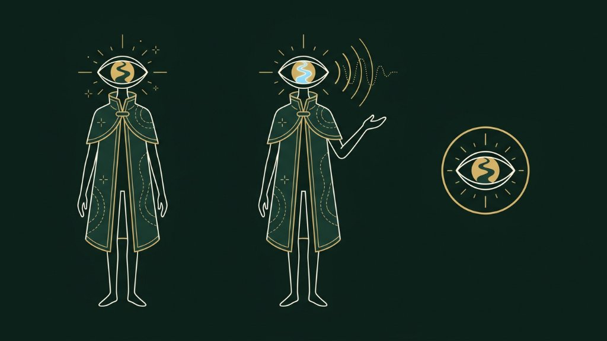

# Branding, boceto y evaluación técnica de Quri

Documento de referencia del repositorio (`README.md`, `docs/architecture.md`, `public/brand/`, `src/app/globals.css`, `src/lib/catalog.ts`, `src/components/basin-hero.tsx`, `src/components/guide.tsx` y `SECURITY.md`) junto con el boceto del personaje **Quri**, los guiones revisados (`v1`) y la evaluación del proveedor de voz **ElevenLabs**.

---

## 1. Identidad de marca y boceto propuesto

- **Proyecto:** Quri-Ñawi («ojo de oro», del quechua *quri* = oro, *ñawi* = ojo).
- **Equipo y reto:** GoldnEye · Gold for Good · ORO-3.3 (*«Mapa vivo de estudios y proyectos sobre mercurio»*).
- **Símbolo oficial (`public/brand/quri-nawi.png`):** *«Un ojo de tinta verde con iris ocre dividido por un río en negativo»* (`docs/architecture.md`).
- **Boceto de personaje (`docs/assets/boceto-quri.jpg`):**

### Adaptación del boceto a la interfaz

Para mantener la estética cartográfica y discreta en escritorio y celular:

1. **Cuerpo completo (`variant="full"`):** Explorador con capa verde bosque (`#14352b`), ribetes dorados (`#d6b66a`) y curvas de nivel punteadas. Se emplea en el diálogo de bienvenida **«Recorrido con Quri»** (`src/components/guide.tsx`).
2. **Busto contextual (`variant="bust"`):** Recorte de hombros, capa y ojo-cabeza para el panel del río seleccionado (`.river-panel` en 3D y vista filtrada en 2D). Cuando reproduce audio (`speaking`), el río del iris se ilumina en celeste (`#8fdcff`), levanta la mano y muestra ondas acústicas doradas (`#ffd36b`).
3. **Medallón minimizado (`variant="medallion"`):** Sello circular tipo brújula («ojito» de `40–44 px`) cuando la persona usuaria minimiza a Quri para despejar el mapa.
4. **Movimiento reducido (`prefers-reduced-motion: reduce`):** Todas las animaciones de ondas o destellos se desactivan automáticamente y quedan como trazos vectoriales estáticos.

---

## 2. Paleta de colores y tipografía de referencia

### Superficie oscura (maqueta 3D y `.river-panel`)

| Uso | Valor | Referencia |
| --- | --- | --- |
| Fondo de la cuenca 3D | `#06120d` → `#102a22` → `#24503f` | `.basin-hero` |
| Paneles traslúcidos | `#0b211aef` / `#0b211aee` | `.river-panel`, `.study-label` |
| Bordes sutiles / destacados | `#ffffff24` / `#ffd36b5c` | `.river-panel`, `.study-label` |
| Acento dorado | `#ffd36b` (hover `#ffe29a`) | `.button.gold`, `.river-tag.has-studies` |
| Ríos sin fichas / iris activo | `#8fdcff` | `.legend-blue`, `.river-tag` |
| Texto principal y secundario | `#fff8e6`, `#dce8dd`, `#a9bdb0` | `.basin-intro`, `.study-label` |

### Superficie clara (atlas 2D y diálogos)

| Token CSS | Valor | Uso |
| --- | --- | --- |
| `--paper` / `--surface` | `#f7f5ed` / `#fffdf6` | Fondo general, tarjetas y diálogos |
| `--forest` / `--dark` | `#183b31` / `#132e26` | Títulos, botones primarios y comparador |
| `--ink` / `--muted` | `#202e27` / `#4c6155` | Texto y metadatos |
| `--gold` / `--gold-dark` | `#d6b66a` / `#875a1c` | Etiquetas *eyebrow* e indicadores |

- **Tipografías:** `Space Grotesk` (`--display`), `Inter` (`--body`) y `Georgia` cursiva en portada (`lang="es-BO"`).

---

## 3. Guiones revisados (`v1`, 30–45 segundos)

Definidos en `src/lib/quri-scripts.ts` a partir de `src/lib/catalog.ts`. Todos separan **fecha de muestreo** y **año de publicación**, declaran el estado **pendiente de revisión**, citan la fuente, conservan las limitaciones de las fichas semilla e indican explícitamente cuando **«faltan fichas en este catálogo»**.

### Río Kaka (`kaka-v1` · ~89 palabras · ~38 s)

> «En el río Kaka este catálogo reúne dos fichas semilla, pendientes de revisión, tomadas de una revisión de la cuenca del Beni publicada en 2025 por la Revista Boliviana de Química. Ambas registran mercurio en sedimentos muestreados en 1998: cero coma cero ochenta y ocho microgramos por gramo en época seca y cero coma doscientos catorce en época húmeda. La ubicación corresponde a un tramo aproximado y falta verificar el punto exacto y el método original. Además, faltan fichas en este catálogo de agua y de peces para este río.»

### Río Beni (`beni-v1` · ~96 palabras · ~40 s)

> «En el río Beni hay tres fichas semilla, pendientes de revisión. Dos analizan peces comestibles: el estudio de Rodriguez-Levy en Heliyon, muestreado entre julio y agosto de 2015 y publicado en 2022, y un estudio de diez especies difundido por la UMSA con publicación de 2025, cuyo muestreo debe consultarse en el artículo. Ambos compraron pescado en mercados de Riberalta y Rurrenabaque, sin confirmar el sitio de captura. La tercera ficha es el programa vigente planetGOLD Bolivia, que no es un punto de muestreo. Además, faltan fichas en este catálogo de agua y de sedimentos.»

### Río Madre de Dios (`madre-de-dios-v1` · ~78 palabras · ~33 s)

> «En el río Madre de Dios este catálogo cuenta con una ficha semilla, pendiente de revisión, basada en el informe piloto de SELADIS y CEDIB sobre mercurio y salud en la Amazonía boliviana, con muestreo de 2023 a 2024 y publicación en 2026. Por resguardo de privacidad, presenta datos agregados con ubicación generalizada a la región, sin comunidades ni personas identificables. Para este río todavía faltan fichas en este catálogo sobre agua, sedimentos y peces.»

### Ríos sin fichas cargadas (`Alto Beni`, `Mamoré`, `Tuichi`, `Coroico`, `Orthon`, `Mapiri`)

> «Para el río [Nombre], todavía faltan fichas en este catálogo. Que no figuren registros aquí no indica ausencia de mercurio ni de investigaciones, sino que aún no se han cargado fuentes verificadas para este cauce en la versión semilla. Si conoces un informe o artículo científico con enlace público o DOI, puedes registrarlo como propuesta en la sección Aportar para su revisión.»

---

## 4. Evaluación de ElevenLabs, licencia y control de cuota

Referencias oficiales: [Documentación TTS](https://elevenlabs.io/docs/overview/capabilities/text-to-speech) y [Planes y precios](https://elevenlabs.io/pricing).

### Créditos y consumo estimado

- **Nivel gratuito (Free Plan):** Incluye **10.000 créditos mensuales** (no acumulables entre ciclos).
- **Consumo del catálogo de Quri-Ñawi (`v1`):**
  - `kaka-v1`: ~535 caracteres
  - `beni-v1`: ~595 caracteres
  - `madre-de-dios-v1`: ~475 caracteres
  - **Total de los 3 ríos con fichas:** **~1.605 caracteres** (~16 % de la cuota mensual gratuita con `eleven_multilingual_v2`, o ~8 % usando `eleven_flash_v2_5` a 0,5 créditos/carácter).
- **Reutilización por versión:**
  1. Los audios revisados `v1` ya están pre-generados y versionados en `public/audio/` (`quri-kaka-v1.mp3`, `quri-beni-v1.mp3`, `quri-madre-de-dios-v1.mp3`) usando voz neural en español de Bolivia (`es-BO-SofiaNeural`, ~177–223 KB cada uno) para garantizar reproducción instantánea, de alta calidad y compatible con la PWA sin conexión.
  2. Si el equipo desea reemplazarlos con voz de ElevenLabs usando los créditos del plan gratuito/comercial, se incluye `scripts/generar-audios-quri.mjs` (`npm run tts:generate`) que genera los mismos archivos versionados una sola vez.
  3. La ruta `/api/quri-tts` reutiliza primero el MP3 versionado en `public/audio/` y, si se genera bajo demanda con API de ElevenLabs, guarda caché en memoria y disco (`.next/cache/quri-tts/`) indexada por `id + version + voz + modelo`.

### Condiciones de licencia y atribución aplicables

- **Uso no comercial en Plan Gratuito:** El nivel gratuito cubre pruebas, prototipos y demostraciones no comerciales (como el piloto de hackathon sin monetización). No otorga derechos comerciales; para uso comercial o institucional remunerado se requiere el plan *Starter* o superior (regenerando los audios bajo suscripción activa).
- **Atribución obligatoria en Plan Gratuito:** Al publicar o compartir audios generados con el plan gratuito debe incluirse crédito explícito a **`elevenlabs.io`** o **`11.ai`**. El componente `QuriAssistant` muestra automáticamente la nota de atribución (`Voz sintetizada · elevenlabs.io`) cuando reproduce audio proveniente de ElevenLabs (configurable mediante `ELEVENLABS_PLAN_COMMERCIAL=true` si se migra a plan de pago).

### Seguridad, cuota y fallback

Cumpliendo `SECURITY.md`:
- **Claves solo en servidor:** `ELEVENLABS_API_KEY` (y opcionales `ELEVENLABS_VOICE_ID`, `ELEVENLABS_MODEL_ID`, `ELEVENLABS_MAX_CHARS_QUOTA`) se leen únicamente en `src/app/api/quri-tts/route.ts` y en `scripts/generar-audios-quri.mjs`.
- **Control de longitud y texto cerrado:** `/api/quri-tts` no acepta texto libre del cliente; solo sintetiza guiones oficiales registrados en `src/lib/quri-scripts.ts` con tope estricto `MAX_SCRIPT_CHARS = 750` y guardia de cuota (`ELEVENLABS_MAX_CHARS_QUOTA`, por defecto `5000` caracteres).
- **Fallback garantizado:** Si no hay clave configurada, se agota la cuota o falla la red, el reproductor ofrece síntesis local del navegador (`SpeechSynthesis` en español) y abre siempre la **lectura de la transcripción completa** con sus fuentes y estado de revisión.
