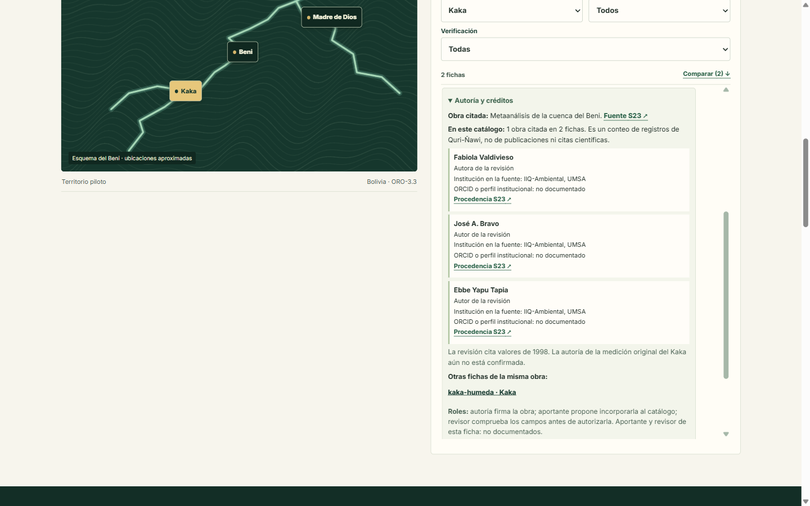
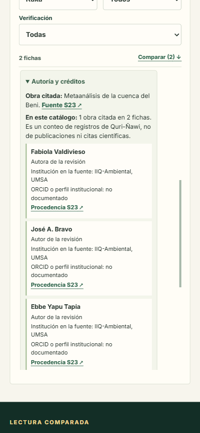

# Propuesta breve: autoría desde cada ficha

Issue [#5](https://github.com/Quri-Nawi/Quri-Nawi/issues/5) · 26 de noviembre de 2026 · rama `JHAMILCALI/feat-autoria-investigadores`

## Decisión de alcance

Una sección plegable **Autoría y créditos** vive dentro de la ficha de la lista, accesible después de elegir un río en el mapa. No añade tarjetas a la portada. Presenta los nombres e instituciones que aparecen en la fuente citada, un enlace a esa procedencia y un acceso para volver al mismo río. Para una obra con varias fichas, muestra los IDs vinculados y permite abrir la otra ficha.

El indicador es **número de fichas de esta versión del catálogo vinculadas a una obra citada**. Dos fichas del Kaka apuntan a una misma revisión (S23), y dos fichas de salud a un mismo informe (S46). Ese número no mide trabajos independientes de una persona, visitas ni citas científicas. No se ofrecen rankings ni perfiles públicos completos: necesitan política de identidad, revisión de afiliaciones y una fuente bibliométrica para citas.

## Procedencia y cautelas

Cada crédito conserva el ID de la fuente en `src/lib/authorship.ts`. El validador comprueba que la ficha cite ese ID. La fuente de los autores del Kaka es la **revisión de SciELO**, no la medición original de 1998; esa autoría continúa desconocida. PubMed respalda autores y afiliaciones del artículo de peces S22; UMSA nombra al equipo de S24; CEDIB atribuye la ficha a Roger Carvajal, mientras la portada del informe lo llama editor. En registros apoyados por prensa se muestra la organización mencionada y se deja la autoría individual sin atribuir. No se asigna un ORCID por coincidencia de nombre.

Fuentes principales: [S23, SciELO](https://www.scielo.org.bo/scielo.php?pid=S0250-54602025000200097&script=sci_arttext), [S22, PubMed](https://pubmed.ncbi.nlm.nih.gov/36444265/), [S24, reseña UMSA](https://dipgis.umsa.bo/?p=7902), [S01, CEDIB](https://www.cedib.org/biblioteca/mercurio-y-salud-en-la-amazonia-boliviana-roger-carvajal/) y [S46, informe CEDIB](https://www.cedib.org/wp-content/uploads/2026/08/MERCURIO-Y-SALUD-EN-LA-AMAZONIA-BOLIVIANA-.pdf).

## Cómo puede aportar o corregir una persona investigadora

Puede abrir la fuente, guardar un borrador con el DOI o enlace y el territorio en **Aporta un estudio**, y conservar el ID de la ficha cuya autoría quiere corregir. Para solicitar una corrección, la propuesta debe aportar la fuente institucional o bibliográfica que demuestre nombre, papel, afiliación o identificador. Un aportante propone; una persona revisora coteja la fuente y autoriza la ficha. El formulario actual guarda el borrador en el dispositivo y aún no lo envía a la cola D1; por eso no se promete seguimiento ni ID de propuesta desde la web.

## Siguiente fase

Definir identidad y consentimiento de perfiles, criterios de desambiguación de nombres, actualización de afiliaciones, flujo de corrección con respuesta al solicitante y fuente bibliométrica con fecha de consulta si se desean citas o vistas. Validar estos puntos con investigadores antes de crear una ruta de perfil o un ranking.

## Evidencia de funcionamiento

En producción local se abrió `/?rio=Kaka`, se usó **Ver en la lista**, se abrió la ficha `kaka-seca` y luego **Autoría y créditos**. El botón de ficha relacionada abrió `kaka-humeda` con los filtros en Kaka; **Volver al río Kaka** mostró de nuevo el panel del río y conservó `?rio=Kaka`. En `dragas-2025` se comprobó que el autor individual aparezca como no documentado y que el regreso abra Madre de Dios. El ancho de documento en móvil fue 390 px para una ventana de 390 px. No se registraron errores de consola en ese recorrido; persiste un aviso deprecado de `THREE.Clock` ajeno a esta vista.

- `npm ci --ignore-scripts`: 130 paquetes, cero vulnerabilidades conocidas al consultar.
- `npm run check`: validación de datos y vínculos de autoría, lint, tipos y compilación de producción completados.
- `npm run smoke` contra el servidor local: verificación HTTP de la aplicación y sus rutas públicas.

