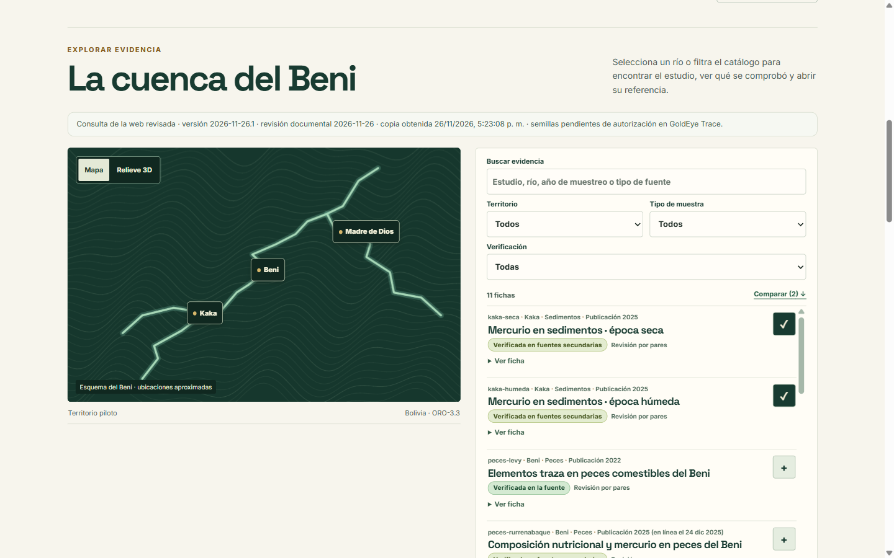
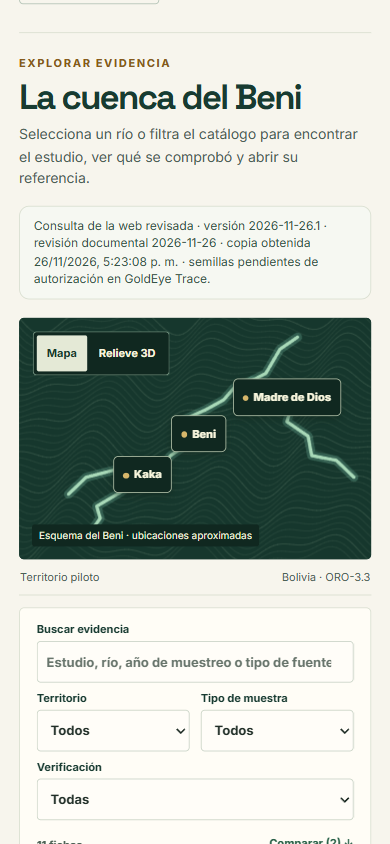

# Verificación del contrato web–MCP

Ramas de trabajo: `JHAMILCALI/feat-catalogo-mcp-adaptador` (web) y `JAHMILCALI/feat-web-read-adapter` (MCP). Fecha: 26 de noviembre de 2026.

## Checks ejecutados

- Web: `npm ci --ignore-scripts`, `npm run check`, `npm run smoke` con `npm run start -- --port 3104`, `npm run smoke:offline`. Todos pasaron. `npm run check` incluyó consistencia de 11 fichas, 52 fuentes y 40 cifras, lint, tipos y compilación.
- MCP: `npm ci --ignore-scripts`, `npm test`, `npm run build`, `npm run smoke:web` contra la web local. Todos pasaron. El empaquetado Wrangler fue *dry run*: no se desplegó el Worker.
- Prueba cruzada real: `buscar_catalogo_web` devolvió `kaka-seca`; `obtener_registro_web` devolvió el mismo ID y `S23`, con versión `2026-11-26.1` y estado `pendiente_revision_mcp`. `buscar_estudios` conservó `total: 0` en el catálogo canónico autorizado.
- El simulador de pérdida de red del *service worker* devolvió la copia de `/api/catalogo` con `X-Quri-Copy: offline`; `/api/fuentes` sin copia devolvió 503.
- Navegador a 1440 × 900 y 390 × 844: el estado de consulta mostró versión, fecha y procedencia. En 390 px, `scrollWidth` y `clientWidth` fueron ambos 390. No hubo entradas en consola. Al elegir Kaka en el mapa 3D y pasar a la lista, mapa, lista y comparación conservaron `kaka-seca` y `kaka-humeda`.

## Capturas

## Alcance pendiente

El formulario web continúa como borrador local, siguiendo la actualización de la issue #4. No se probó el despliegue público del adaptador; las herramientas nuevas se podrán consultar en la URL del Worker después de revisar, fusionar y desplegar el PR del repositorio MCP. No se convirtió ninguna semilla en ficha autorizada.
